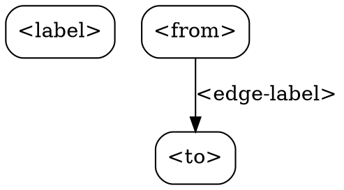

# compile-policy

Transform a Markdown policy document into a structured governance graph (DAG) with nodes, edges, and deterministic evaluation rules.

## Trigger

User says something like:
- `/compile-policy`
- "compile this policy into a graph"
- "turn this governance document into a DAG"
- "parse my policy file"

## What This Skill Does

Takes a Markdown policy document and produces:
1. A JSON graph with typed nodes (section, rule) and labeled edges (contains, requires, conflicts-with, depends-on)
2. A DOT format file for Graphviz visualization
3. A compilation summary with node/edge counts and section breakdown

## Step-by-Step Instructions

### Step 1: Locate the Policy Document

Ask the user to provide the policy. Accept:
- A file path (read it with the Read tool)
- Inline Markdown pasted into the chat
- A URL (fetch with WebFetch if available)

If no policy is provided, ask: "Please provide your policy document — a file path, URL, or paste the Markdown directly."

### Step 2: Parse the Markdown Structure

Walk the document top-to-bottom, building a hierarchical AST:

```
# Level-1 heading  → section node, level=1
## Level-2 heading → section node, level=2
### Level-3 heading → section node, level=3
- bullet point     → rule node under current section
* bullet point     → rule node under current section
plain text line    → rule node under current section (if non-empty)
```

Assign deterministic IDs:
- Sections: `section-{N}` where N increments from 1
- Rules: `rule-{N}` where N increments from 1 (global counter)

### Step 3: Build the Graph JSON

Output structure:

```json
{
  "meta": {
    "source": "<filename or 'inline'>",
    "compiled_at": "<ISO timestamp>",
    "compiler_version": "1.0.0"
  },
  "nodes": [
    {"id": "section-1", "label": "<heading text>", "type": "section", "level": 1},
    {"id": "rule-1", "label": "<rule text>", "type": "rule", "parent": "section-1"}
  ],
  "edges": [
    {"from": "section-1", "to": "rule-1", "label": "contains"}
  ]
}
```

Rules for edges:
- A section contains its immediate child rules: edge label = `"contains"`
- A subsection is contained by its parent section: edge label = `"contains"`
- Detect cross-references in rule text (e.g., "see Section 3", "per rule above") and add `"references"` edges

### Step 4: Generate DOT Format



### Step 5: Write Output Files

Write to a directory named `governance-graph/` in the current workspace:
- `governance-graph/graph.json` — structured graph
- `governance-graph/graph.dot` — Graphviz DOT format

### Step 6: Report Compilation Summary

Print a summary table:

```
Compilation Summary
═══════════════════════════════════════
Source:        <filename>
Total Nodes:   <N>
  Sections:    <N>
  Rules:       <N>
Total Edges:   <N>

Section Breakdown:
─────────────────────────────────────
<section-name>   │ <rule count> rules
  <subsection>   │ <rule count> rules
─────────────────────────────────────

Output:
  governance-graph/graph.json
  governance-graph/graph.dot

Visualize: paste graph.dot into https://dreampuf.github.io/GraphvizOnline/
```

## Deterministic Evaluation Rules

- Compilation is purely structural — no LLM inference about rule meaning
- Same input always produces the same graph (deterministic node IDs)
- Preserve original rule text exactly — do not paraphrase or summarize
- Empty lines and horizontal rules (`---`) are ignored
- Code blocks are treated as a single rule node with label "code block"

## Error Handling

| Situation | Response |
|-----------|----------|
| Empty document | "Policy document is empty. Please provide content." |
| No headings found | Parse all lines as flat rules under a synthetic root section "Policy" |
| File not found | "Cannot read <path>. Please check the path and try again." |
| Very large document (>500 rules) | Warn user, ask if they want to proceed or split the document |

## Output Files

- `governance-graph/graph.json`
- `governance-graph/graph.dot`
